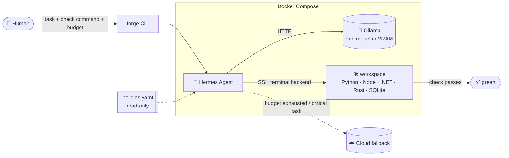
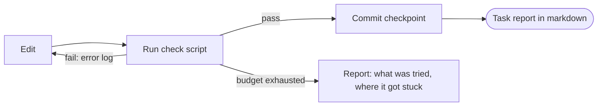

<div align="center">


# Forge

**A local workbench where an LLM agent running on your own GPU takes small development tasks all the way to a green check.**


[Why](#-why-forge) ·
[How it works](#-how-it-works) ·
[Roadmap](#-roadmap) ·
[Benchmark](#-benchmark-suite) ·
[Layout](#-repository-layout) ·
[Security](#-security-model)

</div>

---

## 🔥 Why Forge

Forge is a hobby lab with two goals:

1. **Get things working.** A task counts as solved only when a human-defined check passes: a build, a test suite or a smoke request. The LLM's opinion about its own result is not a check.
2. **Have fun with models.** Swapping models, quantizations and generation settings should take one command, and comparing them should take one more.

What matters:

| ✅ Important | ❌ Not important |
| --- | --- |
| The result builds, runs and passes the check | Code style and elegance |
| The host is safe: the agent can't break the machine, read secrets or rewrite its own rules | Optimal solutions |
| Any state can be rolled back with one command | Production-grade observability |
| Experimenting with models is easy and fun | Rigorous experiment statistics |

**Usefulness metric:** the share of tasks taken to a green check with no manual edits, and the time per task. If it doesn't grow from stage to stage, it's time to stop and rethink.

## ⚙️ How it works



The agent loop is simple and deterministic around the model:



### Key decisions (ADR-001)

| Question | Decision |
| --- | --- |
| Agent | [Hermes Agent](https://github.com/NousResearch/hermes-agent): delegation, skills and sandbox backends out of the box |
| Models | Ollama, one model in memory at a time (fits 16 GB VRAM) |
| Cloud model | Optional fallback, used when the local budget runs out or the task is marked `critical`. Every call is logged |
| Code execution | Hermes terminal backend = SSH into the `workspace` container. **No container gets the Docker socket** |
| Services | Docker Compose |
| Rules and budgets | `policies.yaml`, mounted read-only, out of the agent's reach |
| Controller | `forge` CLI: `validate`, `bench`, `promote`, `rollback` |
| History | Git for configuration plus snapshots of `~/.hermes` |
| Roles | Executor plus a check script. Reviewer and researcher subagents only when needed |
| Versions | Hermes, Ollama and models are pinned. Upgrades go through a benchmark run |

## 🗺️ Roadmap

| Stage | Goal | Gate |
| :---: | --- | --- |
| **0** · Hypothesis | Prove that a model fitting in 16 GB VRAM can drive Hermes on real tasks | ≥ 1 model solves ≥ 50% of the suite with no manual edits, ≤ 20 min per solved task |
| **1** · Bootstrap | Everything comes up with one `docker compose up`, survives restarts, the agent is isolated from the host | Green healthcheck from a clean state, no socket / secrets / policies writable from `workspace` |
| **2** · Agent loop | Edit → check → fix until green or out of budget | 3 real tasks solved hands-off, unsolvable tasks stop with a clear report |
| **3** · Model lab | Compare models and quants with one command | `forge compare A B` prints a table, results survive restarts |
| **4** · Controlled self-modification | The agent proposes config changes, and only `forge promote` applies them after checks | Out-of-whitelist and regressing changes are rejected, `forge rollback` restores a working state |
| **5+** · Extensions | Scheduled benchmarks, autonomous loop (L4), media lab, model gateway… | Each starts with its own short plan |

> Stage 0 is the riskiest one. If its gate fails, the following stages are built around a hybrid setup: the cloud model plans and the local model executes.

## 🧪 Benchmark suite

Nine tasks of increasing difficulty. The task number where a model starts failing is its ceiling. Tests are written once, frozen and mounted read-only for the agent.

| # | Task | Stack | Difficulty | Check |
| :---: | --- | --- | :---: | --- |
| 1 | CLI: expenses CSV → totals by category and month, broken rows handled | Python | ⭐ | `pytest` |
| 2 | Library SQLite DB: 6 queries, from JOINs to window functions and a recursive CTE | SQL + Python | ⭐–⭐⭐ | `pytest` vs reference results |
| 3 | Scrape quotes.toscrape.com: all pages, text, author, tags → JSON | Python | ⭐⭐ | Record count and schema match |
| 4 | Todo app: add, delete, filters, localStorage | TS + React (Vite) | ⭐⭐–⭐⭐⭐ | `npm run build` + `vitest` |
| 5 | nginx log analyzer: status codes, top-10 URLs, broken lines, 100 MB file | Rust | ⭐⭐⭐ | `cargo test` + time limit |
| 6 | Notes REST API: CRUD, validation, EF Core + SQLite, migrations | C# (ASP.NET Core) | ⭐⭐⭐ | `dotnet test` (integration) |
| 7 | Desktop todo list, MVVM, local SQLite | C# (Avalonia) | ⭐⭐⭐–⭐⭐⭐⭐ | `dotnet build` + headless ViewModel tests |
| 8 | books.toscrape.com (1000 books, polite rate limit) → SQLite → FastAPI → React page | Python + SQL + TS + React | ⭐⭐⭐⭐ | `pytest` + `vitest` + smoke request |
| 9 | Find and fix a planted bug in a 5–10k LOC project from a failing test | Python or TS | ⭐⭐⭐⭐⭐ | Failing test green, nothing else broken |

## 📁 Repository layout

```text
forge/
├── benchmarks/
│   └── tasks/              # 9 reference tasks with frozen tests (read-only for the agent)
├── cli/                    # forge CLI: validate · bench · compare · use · promote · rollback
├── config/                 # models.yaml (profiles), policies.yaml (budgets, cloud fallback rules)
├── docker/
│   ├── hermes/             # Hermes Agent image
│   └── workspace/          # sandbox image: sshd, Python, Node.js, .NET SDK, Rust, SQLite
├── .github/
│   └── assets/             # logo and banner
├── docs/
│   └── adr/                # architecture decision records
├── experiments/
│   ├── results/            # benchmark runs (JSONL)
│   └── reports/            # markdown summaries and comparisons
├── journal/                # self-modification log: proposed → checked → applied / rejected
├── logs/                   # JSONL task log (git-ignored)
├── schemas/                # JSON Schemas used by `forge validate`
├── scripts/                # up · down · healthcheck
└── snapshots/
    └── hermes-skills/      # versioned snapshots of ~/.hermes/skills
```

## 🛡️ Security model

- **No Docker socket anywhere.** Neither `hermes` nor `workspace` can talk to the Docker daemon. Hermes reaches the sandbox only over SSH.
- **Secrets stay on the host.** `.env` is never mounted into `workspace`. Only `.env.example` is committed.
- **Rules are out of reach.** `policies.yaml` and the benchmark tasks are mounted read-only. Attempts to change them are part of the acceptance tests.
- **Network is scoped.** `workspace` only reaches package registries and the toscrape.com sandboxes. Only `hermes` has general web access.
- **Everything is reversible.** Every green check is a commit on a per-task branch. Configuration is tagged, and skill snapshots let `forge rollback` restore the previous state with no manual edits.

## 🚀 Getting started

> 🚧 Forge is at **Stage 0**. The commands below describe the target interface and will appear as the stages land.

**Prerequisites:** Windows 11 + WSL2 (projects live inside the WSL filesystem, not `/mnt/c`), an NVIDIA GPU with 16 GB VRAM, Docker with the NVIDIA Container Toolkit.

```bash
# bring the stack up and check it
cp .env.example .env
scripts/up
scripts/healthcheck

# model lab
forge bench qwen-coder-q4      # run the suite, 3 repeats per task
forge compare qwen-coder-q4 devstral-q4
forge use devstral-q4          # switch the working profile

# controlled self-modification
forge validate                 # schema + whitelist check
forge promote                  # validate → short benchmark → apply if not worse
forge rollback                 # previous config tag + skills snapshot

scripts/down
```

## 🚫 Deliberately out of scope

A custom agent framework, Kubernetes and message brokers, a custom monitoring dashboard, several models in memory at once, full autonomy by default.

---

<div align="center">
<sub>Built for fun on one GPU · forged with 🔨 and a lot of failing tests</sub>
</div>
